<h1 align="center"><b>Senior Full Stack Engineer</b></h1>

Istanbul, Turkey · from Ukraine 🇺🇦 · 3+ years professional experience

---

## Experience

<a href="https://listening.com"></a><a href="https://www.upwork.com/freelancers/~010112495fc6870d30"></a>

## Tech Stack


---

## Projects

<a href="https://github.com/Marve10s/Better-Fullstack"></a><a href="https://github.com/Marve10s/awesome-effect"></a>

## Security

<a href="https://github.com/Effect-TS/effect/security"></a>

## Contributed to

<a href="https://github.com/pulls?q=is%3Apr+author%3AMarve10s+is%3Amerged+repo%3AEffect-TS%2Feffect"></a><a href="https://github.com/pulls?q=is%3Apr+author%3AMarve10s+is%3Amerged+repo%3Apingdotgg%2Ft3code"></a><a href="https://github.com/react/react-native/commits?author=Marve10s"></a><a href="https://github.com/pulls?q=is%3Apr+author%3AMarve10s+is%3Amerged+repo%3Amui%2Fmaterial-ui"></a>


<a href="https://github.com/pulls?q=is%3Apr+author%3AMarve10s+is%3Amerged+-user%3AMarve10s"></a>

---

## GitHub Stats

